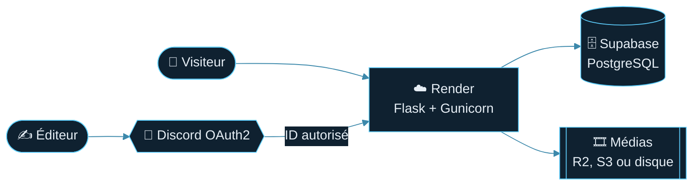

<div align="center">



     

<br><br>

<a href="docs/Home.md"></a>
<a href="docs/01-Installation-locale.md"></a>

<sub> Site de blogs francophone · lecture publique · édition réservée aux comptes Discord autorisés</sub>

</div>


## ✨ Fonctionnalités

| | |
|---|---|
| 🌍 **Lecture publique** | Accueil animé, archives paginées, recherche, départements, tags, articles liés, RSS, sitemap |
| 🔐 **Édition protégée** | Connexion **Discord OAuth2** + liste blanche d'ID vérifiée côté serveur |
| ✍️ **Éditeur Markdown** | Aperçu en direct, brouillon local, texte expurgé `\|\|secret\|\|` |
| 🖼️ **Médias libres** | Images, GIF, vidéos, galeries, YouTube : avant, après, entre les paragraphes, à gauche, à droite… |
| ✨ **Animations** | Séquence de démarrage, titre *glitch*, neige TV, halo de souris, cartes 3D, barre de lecture |
| 🚀 **Prêt pour la prod** | PostgreSQL, stockage S3/R2, CSRF, CSP stricte, limitation de requêtes |

## 🏗️ Architecture



## 🚀 Démarrage rapide

<details open>
<summary><b>💻 Windows (PowerShell)</b></summary>

```powershell
python -m venv .venv
.\.venv\Scripts\Activate.ps1
pip install -r requirements.txt
copy .env.example .env      # puis remplis le fichier
python app.py               # http://127.0.0.1:5000
```
</details>

<details>
<summary><b>🍎 macOS / Linux</b></summary>

```bash
python3 -m venv .venv && source .venv/bin/activate
pip install -r requirements.txt
cp .env.example .env
python app.py
```
</details>

> [!IMPORTANT]
> Ouvre **`http://127.0.0.1:5000`** (pas `localhost`) et renseigne `.env` : voir [Configuration](docs/02-Configuration.md) et [Connexion Discord](docs/03-Discord-OAuth.md).

## 📚 Documentation (wiki)

| | Page | Contenu |
|:-:|---|---|
| 💻 | [**Installation locale**](docs/01-Installation-locale.md) | Installer Python, lancer le site sur ton PC. |
| ⚙️ | [**Configuration**](docs/02-Configuration.md) | Toutes les variables, leur rôle et leurs valeurs. |
| 🔐 | [**Connexion Discord**](docs/03-Discord-OAuth.md) | Créer l'application, le secret, les redirections. |
| 🐙 | [**GitHub**](docs/04-GitHub.md) | Mettre le code en ligne et le mettre à jour. |
| 🚀 | [**Déploiement Render**](docs/05-Render.md) | Héberger le site, domaine, logs, limites. |
| 🗄️ | [**Base de données**](docs/06-Base-de-donnees.md) | Supabase, Session pooler, schéma, sauvegardes. |
| 🎞️ | [**Médias et stockage**](docs/07-Medias.md) | Images et vidéos durables avec R2 / S3. |
| ✍️ | [**Rédiger un article**](docs/08-Rediger.md) | Markdown, médias placés où tu veux, aperçu. |
| 🛠️ | [**Administration**](docs/09-Administration.md) | Studio, brouillons, publication, suppression. |
| 🛡️ | [**Sécurité**](docs/10-Securite.md) | Ce qui est protégé et ce qu'il te reste à faire. |
| 🧬 | [**Architecture**](docs/11-Architecture.md) | Comment le code est organisé. |
| 🎨 | [**Personnalisation**](docs/12-Personnalisation.md) | Adapter le nom, les départements, le thème. |
| 🩺 | [**Dépannage / FAQ**](docs/13-Depannage.md) | Un symptôme, une cause, une solution. |
| 🔧 | [**Maintenance**](docs/14-Maintenance.md) | Faire durer et grandir le site. |

👉 **Point d'entrée : [le sommaire du wiki](docs/Home.md)**

## 🗂️ Structure

```text
app.py            serveur Flask (routes, auth, base, médias)
content.py        rendu Markdown + shortcodes médias (assaini)
templates/        pages HTML (Jinja)
static/css/       style.css (thème et animations)
static/js/        main.js (animations), editor.js (éditeur)
docs/             wiki illustré (bannières, schémas Mermaid)
wiki/             copie prête à pousser sur le wiki GitHub
render.yaml       déploiement Render (variante gratuite)
.env.example      modèle de configuration
```

## ⚖️ Licence et crédits

Projet de fan **non officiel**, non affilié à la Fondation SCP. Les contenus issus du wiki SCP sont sous licence **CC BY-SA 3.0** : cite les auteurs et conserve la même licence. Ajoute le fichier de licence de ton choix pour le code.

<div align="center">


<sub>⛨ <b>SCP Foundation</b> · <a href="docs/Home.md">Wiki</a> · <a href="docs/13-Depannage.md">Dépannage</a> · <a href="#">⬆ retour en haut</a></sub>

</div>
