<!--built-->
<div align="center">



  

<a href="Home.md"></a> <a href="02-Configuration.md"></a>

</div>

<details>
<summary>📑 <b>Dans cette page</b> (7 sections)</summary>

- [📋 Prérequis](#-prérequis)
- [🪜 Étapes (Windows PowerShell)](#-étapes-windows-powershell)
- [🔹 macOS / Linux](#-macos--linux)
- [🔹 Remplir `.env`](#-remplir-env)
- [▶️ Lancer](#-lancer)
- [🔎 Ce qui se passe au premier lancement](#-ce-qui-se-passe-au-premier-lancement)
- [🪤 Pièges fréquents sous Windows](#-pièges-fréquents-sous-windows)

</details>

## 📋 Prérequis
- **Python 3.11 ou plus récent** (`python --version`).
- **Git** (pour la suite) : <https://git-scm.com>.
- Un éditeur de texte (VS Code, Bloc-notes…).

## 🪜 Étapes (Windows PowerShell)

```mermaid
%%{init: {"theme":"base","themeVariables":{"primaryColor":"#0f2130","primaryTextColor":"#e6eef5","primaryBorderColor":"#5fd0ff","lineColor":"#3d89ab","secondaryColor":"#1a0d14","tertiaryColor":"#0b1824","edgeLabelBackground":"#0f2130","fontFamily":"ui-monospace, Menlo, Consolas, monospace","noteBkgColor":"#1a0d14","noteTextColor":"#ffb4bb","actorBkg":"#0f2130","actorBorder":"#5fd0ff","actorTextColor":"#e6eef5","signalColor":"#3d89ab","signalTextColor":"#3d89ab","labelBoxBkgColor":"#0f2130","labelTextColor":"#e6eef5","loopTextColor":"#3d89ab"}}}%%
flowchart LR
  A["📥 Récupérer le dossier"] --> B["🐍 python -m venv .venv"] --> C["📦 pip install -r requirements.txt"] --> D["📝 Créer le fichier .env"] --> E["▶️ python app.py"] --> F(["🌐 127.0.0.1:5000"])
  class F ok
  classDef cloud fill:#0f2130,stroke:#5fd0ff,color:#e6eef5
  classDef ok fill:#0c241b,stroke:#5dffb0,color:#e6eef5
  classDef bad fill:#241219,stroke:#ff4d5e,color:#ffb4bb
```




```powershell
cd "C:\chemin\vers\scp_public"
python -m venv .venv
.\.venv\Scripts\Activate.ps1
python -m pip install -r requirements.txt
copy .env.example .env
```

Si PowerShell refuse d'activer l'environnement (« l'exécution de scripts est désactivée ») :
```powershell
Set-ExecutionPolicy -Scope CurrentUser RemoteSigned
```

## 🔹 macOS / Linux
```bash
python3 -m venv .venv && source .venv/bin/activate
pip install -r requirements.txt
cp .env.example .env
```

## 🔹 Remplir `.env`
Voir [Configuration](02-Configuration.md). Minimum pour tester : `FLASK_SECRET_KEY`, `DISCORD_CLIENT_ID`, `DISCORD_CLIENT_SECRET`, `DISCORD_REDIRECT_URI`, `ADMIN_DISCORD_IDS`.

## ▶️ Lancer

> [!IMPORTANT]
> Ouvre le site sur **`http://127.0.0.1:5000`** et **pas** `localhost` : c'est l'adresse déclarée dans Discord, sinon la connexion échoue.

```powershell
python app.py
```
Ouvre **http://127.0.0.1:5000** (utilise exactement cette adresse, pas `localhost`, pour que la connexion Discord fonctionne).

## 🔎 Ce qui se passe au premier lancement
- Sans `DATABASE_URL`, le site crée une base **SQLite** locale `scp_site.db` dans le dossier du projet.
- Les tables sont créées automatiquement et **3 articles de démonstration** sont ajoutés si la base est vide.
- Les médias envoyés sont stockés dans `uploads/`.

## 🪤 Pièges fréquents sous Windows
| Problème | Solution |
|---|---|
| Le fichier s'appelle `.env.txt` | Active « Extensions de noms de fichiers » dans l'Explorateur et renomme en `.env` |
| `.env` modifié mais sans effet | Arrête le serveur (Ctrl+C) et relance |
| Variable Windows qui écrase `.env` | `Remove-Item Env:DISCORD_CLIENT_ID, Env:DISCORD_CLIENT_SECRET -ErrorAction SilentlyContinue` |
| `pip` introuvable | Utilise `python -m pip ...` |

<div align="center">


<a href="Home.md"></a> <a href="02-Configuration.md"></a>

<sub><a href="02-Configuration.md">⚙️ Configuration</a> ▶</sub>


<sub>⛨ <b>SCP Foundation</b> — projet de fan non officiel · contenus SCP sous licence CC BY-SA 3.0 lorsque applicable · <a href="#">⬆ retour en haut</a></sub>

</div>
