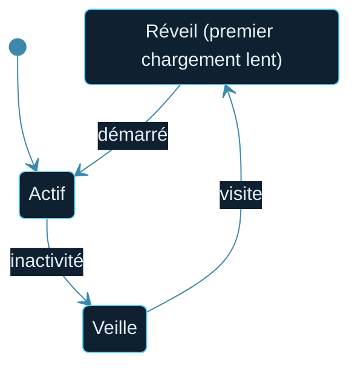

<!--built-->

  

  

📑 <b>Dans cette page</b> (9 sections)

- [🆕 Créer le service web](#-créer-le-service-web)
- [🧩 Variables (onglet Environment)](#-variables-onglet-environment)
- [📐 Blueprint (optionnel)](#-blueprint-optionnel)
- [✅ Vérifier](#-vérifier)
- [📜 Logs](#-logs)
- [⚠️ Offre gratuite : limites](#-offre-gratuite--limites)
- [💳 Passer en payant](#-passer-en-payant)
- [🌐 Nom de domaine personnalisé](#-nom-de-domaine-personnalisé)
- [🔁 Déploiement automatique et retour arrière](#-déploiement-automatique-et-retour-arrière)

## 🆕 Créer le service web
render.com → **New → Web Service** → connecte GitHub → choisis le dépôt.

| Champ | Valeur |
|---|---|
| Name | `scp-foundation` (devient `https://<name>.onrender.com`, avec suffixe aléatoire si le nom est pris) |
| Runtime | Python 3 |
| Build Command | `pip install -r requirements.txt` |
| Start Command | `gunicorn app:app --workers 1 --threads 4 --timeout 180 --bind 0.0.0.0:$PORT` |
| Instance Type | Free (test) ou payant |
| Health Check Path | `/healthz` |

## 🧩 Variables (onglet Environment)

| Variable | Valeur |
|---|---|
| `PYTHON_VERSION` | `3.12.7` |
| `FLASK_SECRET_KEY` | longue valeur aléatoire |
| `DATABASE_URL` | adresse Supabase « Session pooler » ([page 6](06-Base-de-donnees.md)) |
| `DISCORD_CLIENT_ID` / `DISCORD_CLIENT_SECRET` | depuis le portail Discord |
| `DISCORD_REDIRECT_URI` | `https://TON-ADRESSE/auth/callback` |
| `ADMIN_DISCORD_IDS` | tes ID séparés par des virgules |
| `SITE_URL` | `https://TON-ADRESSE` (sans `/` final) |

Chaque enregistrement de variable redéploie le service.

## 📐 Blueprint (optionnel)

> [!TIP]
> Le fichier `render.yaml` fourni décrit déjà le service (variante **gratuite**). Il ne crée pas la base : colle l'adresse Supabase dans `DATABASE_URL`.

`render.yaml` décrit le service (variante gratuite, base externe). **New → Blueprint** le lit ; les variables `sync: false` sont à saisir à la main.

## ✅ Vérifier
- Statut **Live** sur le tableau de bord.
- `https://TON-ADRESSE/healthz` affiche `ok`.
- « Accès éditeur » → Discord → Studio.

## 📜 Logs
Onglet **Logs** : erreurs Python, requêtes, connexion à la base. Erreurs typiques dans [Dépannage](13-Depannage.md).

## ⚠️ Offre gratuite : limites

> [!NOTE]
> Sur l'offre gratuite, **aucune donnée locale n'est conservée** et le site se met en veille. C'est pour cela que la base (Supabase) et les médias (R2/S3) sont externes.

- Mise en veille après inactivité ; **premier chargement lent** au réveil.
- **Pas de disque persistant** : les fichiers locaux disparaissent à chaque redéploiement → base externe et [médias externes](07-Medias.md) obligatoires.
- Ressources limitées : garde `--workers 1`.

## 💳 Passer en payant
- Plus de mise en veille, plus de ressources, disque persistant possible.
- Avec un **disque**, une seule instance ; pour plusieurs instances, utilise R2/S3.

## 🌐 Nom de domaine personnalisé
1. Service → **Settings → Custom Domains** → ajoute ton domaine.
2. Crée l'enregistrement DNS demandé (CNAME/A) chez ton registrar ; Render émet le certificat HTTPS.
3. **Mets à jour** `SITE_URL`, `DISCORD_REDIRECT_URI` **et** le Redirect du portail Discord.

## 🔁 Déploiement automatique et retour arrière
Chaque `git push` sur la branche suivie redéploie. Un déploiement raté laisse l'ancienne version en ligne. Pour revenir en arrière, redéploie une version précédente depuis l'historique des déploiements.

  

◀ <a href="04-GitHub.md">🐙 GitHub</a>&nbsp;&nbsp;·&nbsp;&nbsp;<a href="06-Base-de-donnees.md">🗄️ Base de données</a> ▶

⛨ <b>SCP Foundation</b> — projet de fan non officiel · contenus SCP sous licence CC BY-SA 3.0 lorsque applicable · <a href="#">⬆ retour en haut</a>

