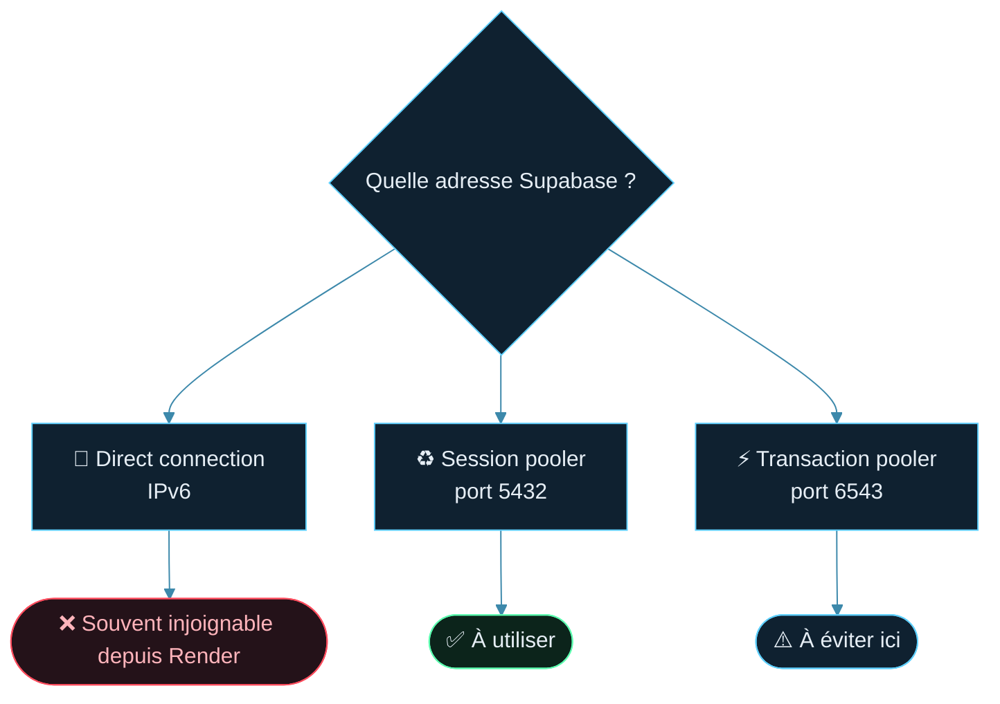
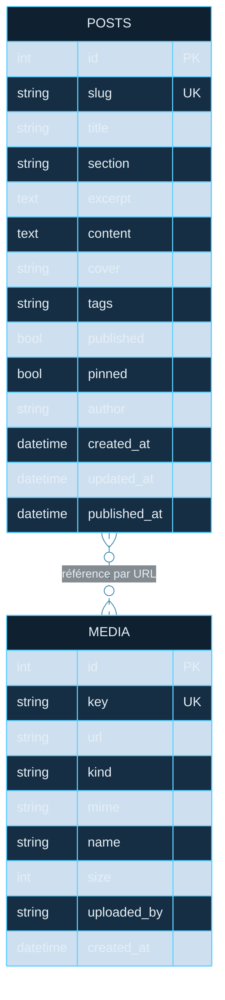

<!--built-->
<div align="center">



  

<a href="05-Render.md"></a> <a href="Home.md"></a> <a href="07-Medias.md"></a>

</div>

<details>
<summary>📑 <b>Dans cette page</b> (8 sections)</summary>

- [🎯 Rôle](#-rôle)
- [🆕 Créer la base gratuite sur Supabase](#-créer-la-base-gratuite-sur-supabase)
- [🧭 Choisir la bonne adresse (bouton **Connect**)](#-choisir-la-bonne-adresse-bouton-connect)
- [🔌 Brancher le site](#-brancher-le-site)
- [🗺️ Schéma](#-schéma)
- [✅ Limites de l'offre gratuite (à vérifier sur Supabase)](#-limites-de-loffre-gratuite-à-vérifier-sur-supabase)
- [💾 Sauvegarde manuelle](#-sauvegarde-manuelle)
- [🩺 Dépannage](#-dépannage)

</details>

## 🎯 Rôle
La base stocke les **textes** (articles, métadonnées, liste des médias). Les fichiers médias sont ailleurs ([page 7](07-Medias.md)).

Sans `DATABASE_URL`, le site utilise SQLite locale (développement). **En production, utilise PostgreSQL** : sur Render gratuit, un fichier SQLite serait effacé à chaque redéploiement.

## 🆕 Créer la base gratuite sur Supabase
1. supabase.com → **New project** : nom, **mot de passe de base** (note-le ; évite `@ : / ? # %` ou encode-les), région proche de Render.
2. Attends la fin de la création.

## 🧭 Choisir la bonne adresse (bouton **Connect**)

> [!TIP]
> Choisis toujours **Session pooler (port 5432)** : il passe en IPv4 et fonctionne avec Render.




| Mode | Verdict |
|---|---|
| Direct connection | ❌ souvent IPv6 seulement sur l'offre gratuite, inaccessible depuis Render |
| **Session pooler (port 5432)** | ✅ **à utiliser** (IPv4) |
| Transaction pooler (port 6543) | ⚠️ à éviter avec ce site |

Forme :
```
postgresql://postgres.<ref>:<MOT_DE_PASSE>@aws-0-<region>.pooler.supabase.com:5432/postgres
```
Remplace `[YOUR-PASSWORD]` par le mot de passe **sans crochets**. Le site convertit lui-même le préfixe pour le pilote `psycopg`.

Caractères spéciaux à encoder : `@` → `%40`, `#` → `%23`, `/` → `%2F`, `:` → `%3A`.

## 🔌 Brancher le site
- Render → Environment → `DATABASE_URL=<adresse>`.
- Au démarrage, les tables `posts` et `media` sont créées si absentes, et 3 articles de démonstration sont ajoutés si `posts` est vide.
- Contrôle dans Supabase → **Table Editor**.

## 🗺️ Schéma




**posts** : `id` (PK), `slug` (unique, adresse `/a/<slug>`), `title`, `section` (clé : `dossiers-scp`…), `excerpt`, `content` (Markdown + shortcodes), `cover` (URL), `tags` (format `,tag1,tag2,`), `published`, `pinned`, `author`, `created_at`, `updated_at`, `published_at` (UTC).

**media** : `id`, `key` (unique), `url`, `kind` (`image`/`video`), `mime`, `name`, `size`, `uploaded_by`, `created_at`.

## ✅ Limites de l'offre gratuite (à vérifier sur Supabase)

> [!WARNING]
> Un projet Supabase gratuit **inactif peut être mis en pause** : le site renverra des erreurs tant qu'il n'est pas relancé depuis le tableau de bord.

- Un projet inactif peut être **mis en pause** : le site renvoie des erreurs 500 tant qu'il n'est pas relancé depuis le tableau de bord.
- Stockage et connexions limités ; le site garde un petit pool (3 + 2 connexions par worker). Garde `--workers 1` ou 2.

## 💾 Sauvegarde manuelle
Avec les outils PostgreSQL installés :
```powershell
pg_dump "postgresql://postgres.<ref>:<MDP>@aws-0-<region>.pooler.supabase.com:5432/postgres" -f sauvegarde.sql
```
Restauration : `psql "<adresse>" -f sauvegarde.sql`. Ne commit jamais ces fichiers. Vérifie dans ton tableau de bord quelles sauvegardes automatiques incluent ton offre.

## 🩺 Dépannage
| Symptôme | Piste |
|---|---|
| `could not translate host name` / timeout | Mauvaise adresse ou mode Direct (IPv6) → Session pooler |
| `password authentication failed` | Mot de passe faux ou mal encodé → le réinitialiser dans Supabase (Settings → Database) |
| `too many connections` / `MaxClients…` | Réduire `--workers` |
| Erreurs après des jours sans visite | Projet en pause → le relancer |
| Tables absentes | Le site n'a pas démarré : lire les Logs Render |

<div align="center">


<a href="05-Render.md"></a> <a href="Home.md"></a> <a href="07-Medias.md"></a>

<sub>◀ <a href="05-Render.md">🚀 Déploiement Render</a>&nbsp;&nbsp;·&nbsp;&nbsp;<a href="07-Medias.md">🎞️ Médias et stockage</a> ▶</sub>


<sub>⛨ <b>SCP Foundation</b> — projet de fan non officiel · contenus SCP sous licence CC BY-SA 3.0 lorsque applicable · <a href="#">⬆ retour en haut</a></sub>

</div>
