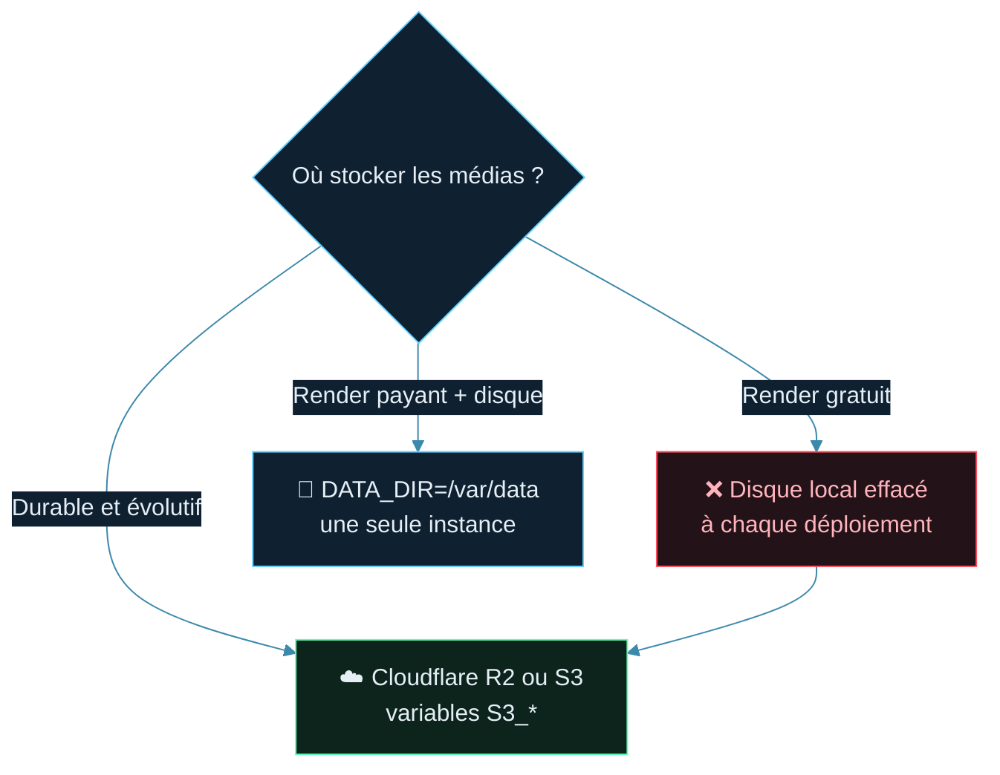
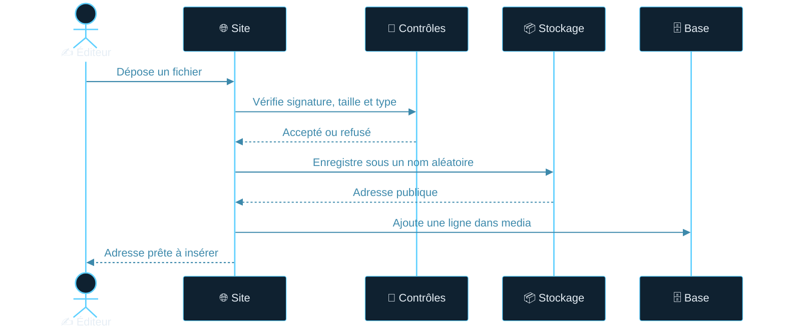

<!--built-->

  

  

📑 <b>Dans cette page</b> (7 sections)

- [🧾 Formats acceptés](#-formats-acceptés)
- [📦 Où vont les fichiers ?](#-où-vont-les-fichiers-)
- [💳 Option A — Disque persistant Render (payant)](#-option-a--disque-persistant-render-payant)
- [🅱️ Option B — Cloudflare R2 (recommandé pour durer)](#-option-b--cloudflare-r2-recommandé-pour-durer)
- [🔁 Changer de stockage plus tard](#-changer-de-stockage-plus-tard)
- [🎞️ Supprimer un média](#-supprimer-un-média)
- [✅ Bonnes pratiques](#-bonnes-pratiques)

## 🧾 Formats acceptés
| Type | Formats | Taille max (réglable) |
|---|---|---|
| Image | PNG, JPG, GIF, WEBP | 12 Mo (`MAX_IMAGE_MB`) |
| Vidéo | MP4, WEBM | 80 Mo (`MAX_VIDEO_MB`) |

Le serveur lit la **signature réelle** du fichier : renommer un `.exe` en `.png` ne fonctionne pas. Le SVG est refusé volontairement (risque de script). Pour qu'une vidéo MP4 se lise dans tous les navigateurs, encode-la en **H.264 + AAC**.

## 📦 Où vont les fichiers ?

> [!WARNING]
> Sur **Render gratuit**, le disque local est **effacé à chaque redéploiement** : les articles afficheraient des images cassées. Utilise R2/S3 (ou un disque Render payant).

Chaque fichier reçoit un nom aléatoire (`<28 caractères hexadécimaux>.png`), sans rapport avec le nom d'origine. Son adresse est enregistrée dans la table `media`, puis réutilisée dans les articles.

| Mode | Activation | Adresse produite |
|---|---|---|
| **Disque local** | par défaut (`DATA_DIR/uploads`) | `/media/<nom>` |
| **S3 / Cloudflare R2** | variable `S3_BUCKET` définie | `<S3_PUBLIC_URL>/<nom>` |

⚠️ **Sur Render gratuit, le disque local est effacé à chaque redéploiement** : les articles afficheraient des images cassées. Utilise R2/S3 (ou un disque Render payant).

## 💳 Option A — Disque persistant Render (payant)
1. Service → **Disks** → ajoute un disque monté sur `/var/data`.
2. Variable `DATA_DIR=/var/data`.
3. Limite : une seule instance du service.

## 🅱️ Option B — Cloudflare R2 (recommandé pour durer)

Offre gratuite avec quota, qui peut demander un moyen de paiement à l'inscription : vérifie les conditions actuelles.

1. Cloudflare → **R2** → **Create bucket** (ex. `scp-medias`).
2. **Accès public** du bucket : active le domaine `r2.dev` (pour tester) ou, mieux, connecte un **domaine personnalisé**. Note l'adresse publique obtenue.
3. **Manage API tokens** → crée un jeton avec droit **Object Read & Write** sur ce bucket. Note l'*Access Key ID*, le *Secret* et l'*adresse S3* (`https://<ACCOUNT_ID>.r2.cloudflarestorage.com`).
4. Dans le dépôt, **décommente** `boto3` dans `requirements.txt`, puis `git push`.
5. Sur Render, ajoute :

| Variable | Valeur |
|---|---|
| `S3_BUCKET` | `scp-medias` |
| `S3_ENDPOINT_URL` | `https://<ACCOUNT_ID>.r2.cloudflarestorage.com` |
| `S3_PUBLIC_URL` | adresse publique du bucket, sans `/` final |
| `S3_ACCESS_KEY_ID` | clé d'accès |
| `S3_SECRET_ACCESS_KEY` | secret |
| `S3_REGION` | `auto` |

6. Redéploie, envoie une image dans l'éditeur : l'adresse affichée doit commencer par `S3_PUBLIC_URL`.

Autres services compatibles S3 (Backblaze B2, AWS S3, Supabase Storage via son endpoint S3) : mêmes variables.

## 🔁 Changer de stockage plus tard
Les articles contiennent l'adresse **complète** des médias au moment de l'envoi. Si tu changes de stockage ou de domaine, les anciennes adresses ne sont **pas** réécrites : copie les fichiers vers le nouveau stockage en gardant les mêmes noms et la même adresse publique, ou corrige les articles.

## 🎞️ Supprimer un média
Bouton **Supprimer** dans la bibliothèque : supprime le fichier et la ligne en base. Les articles qui l'utilisent afficheront un lien cassé.

## ✅ Bonnes pratiques
- Compresse les images (≈ 1600 px de large suffisent) et préfère WEBP/JPG aux gros PNG.
- Pour les animations, une courte vidéo MP4 avec l'option `loop` est bien plus légère qu'un GIF.
- Les vidéos lourdes coûtent de la bande passante : mets un CDN devant ou héberge-les sur YouTube (`[[youtube: …]]`).
- Les envois très lourds peuvent atteindre les limites de requête de l'hébergeur ou d'un proxy (certains plafonnent à ≈ 100 Mo).

  

◀ <a href="06-Base-de-donnees.md">🗄️ Base de données</a>&nbsp;&nbsp;·&nbsp;&nbsp;<a href="08-Rediger.md">✍️ Rédiger un article</a> ▶

⛨ <b>SCP Foundation</b> — projet de fan non officiel · contenus SCP sous licence CC BY-SA 3.0 lorsque applicable · <a href="#">⬆ retour en haut</a>

