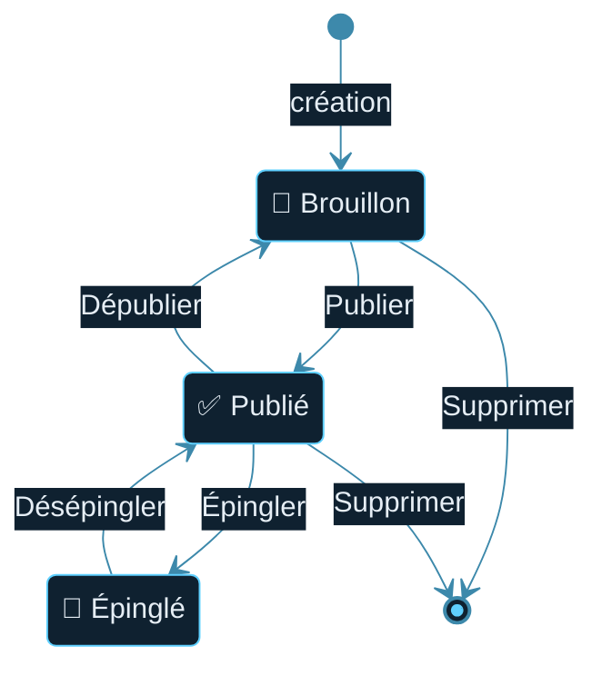

<!--built-->

  

  

📑 <b>Dans cette page</b> (7 sections)

- [🔓 Accès](#-accès)
- [📊 Tableau de bord](#-tableau-de-bord)
- [♻️ Cycle de vie d'un document](#-cycle-de-vie-dun-document)
- [👥 Gérer les éditeurs](#-gérer-les-éditeurs)
- [🎞️ Médias](#-médias)
- [🏛️ Départements](#-départements)
- [✅ Bonnes pratiques éditoriales](#-bonnes-pratiques-éditoriales)

## 🔓 Accès
« Accès éditeur » → Discord → **Studio** (`/admin`). Session de **12 h** ; **Déconnexion** dans le menu.

## 📊 Tableau de bord
- Compteurs : documents, publiés, brouillons, médias.
- Filtre par titre ; liste triée par dernière modification.
- Actions par document : **Modifier**, **Voir**, **Publier/Dépublier**, **Supprimer** (avec confirmation).

## ♻️ Cycle de vie d'un document

1. **Brouillon** : invisible du public ; les éditeurs le voient via **Voir** (bandeau « BROUILLON »).
2. **Publié** : visible partout (accueil, archives, section, tags, RSS, sitemap) ; la date de première publication est conservée.
3. **Épinglé** : remonte en tête de l'accueil (grande carte).
4. **Dépublié** : redevient brouillon, rien n'est supprimé.
5. **Supprimé** : effacé définitivement de la base (les médias restent dans la bibliothèque).

## 👥 Gérer les éditeurs
- Ajouter/retirer un compte : modifier `ADMIN_DISCORD_IDS` ([page 3](03-Discord-OAuth.md)).
- L'auteur affiché est le **nom Discord** de la personne qui a **créé** le document.
- Tous les éditeurs ont les **mêmes droits** (créer, modifier, supprimer tous les documents, gérer les médias). Il n'y a pas de rôles distincts ni d'historique des modifications.

## 🎞️ Médias
La bibliothèque est commune à tous les éditeurs ([page 7](07-Medias.md)). Supprimer un média casse son affichage dans les articles qui l'utilisent.

## 🏛️ Départements
Les 5 départements sont définis dans `app.py` (`SECTIONS`). Pour en ajouter, voir [Personnalisation](12-Personnalisation.md).

## ✅ Bonnes pratiques éditoriales
- Garde la liste d'éditeurs courte et de confiance.
- Relis l'aperçu avant de publier ; vérifie les droits des images et textes repris.
- Ajoute la mention d'attribution CC BY-SA 3.0 pour tout contenu issu du wiki SCP.

  

◀ <a href="08-Rediger.md">✍️ Rédiger un article</a>&nbsp;&nbsp;·&nbsp;&nbsp;<a href="10-Securite.md">🛡️ Sécurité</a> ▶

⛨ <b>SCP Foundation</b> — projet de fan non officiel · contenus SCP sous licence CC BY-SA 3.0 lorsque applicable · <a href="#">⬆ retour en haut</a>

