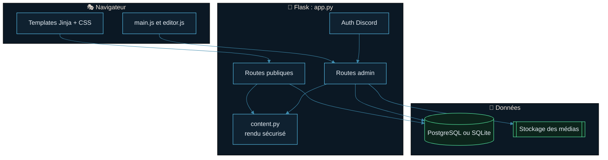

<!--built-->
<div align="center">



  

<a href="10-Securite.md"></a> <a href="Home.md"></a> <a href="12-Personnalisation.md"></a>

</div>

<details>
<summary>📑 <b>Dans cette page</b> (9 sections)</summary>

- [🗂️ Fichiers](#-fichiers)
- [🧱 Technologies](#-technologies)
- [🛣️ Routes publiques](#-routes-publiques)
- [🛣️ Routes d'administration (éditeurs)](#-routes-dadministration-éditeurs)
- [⚙️ Pipeline de rendu d'un article](#-pipeline-de-rendu-dun-article)
- [🔐 Connexion](#-connexion)
- [📦 Stockage](#-stockage)
- [🍪 Base de données](#-base-de-données)
- [🎭 Front-end](#-front-end)

</details>

## 🗂️ Fichiers



```
scp_public/
├─ app.py            Flask : configuration, base, stockage, auth Discord, routes, erreurs
├─ content.py        Markdown + shortcodes médias → HTML assaini ; slug ; tags ; résumé
├─ requirements.txt  Dépendances Python
├─ render.yaml       Déploiement Render (variante gratuite)
├─ .env.example      Modèle de configuration
├─ templates/        base, home, archives, article, admin, editor, login, forbidden, error, _macros
├─ static/css/       style.css (thème, animations, éditeur)
├─ static/js/        main.js (animations, lecteur), editor.js (éditeur de médias)
├─ uploads/          médias en mode disque local
└─ docs/             wiki
```

## 🧱 Technologies
Flask 3 · SQLAlchemy 2 (Core) · psycopg 3 / SQLite · Flask-Limiter · Markdown + bleach · requests (Discord) · Gunicorn (production) · boto3 (optionnel, S3/R2).

## 🛣️ Routes publiques
| Route | Rôle |
|---|---|
| `/` | Accueil (article épinglé/récent, départements, compteurs) |
| `/archives?q=&section=&page=` | Archives paginées, recherche, filtre |
| `/section/<slug>` | Un département |
| `/tag/<tag>` | Un tag |
| `/a/<slug>` | Un article (brouillons visibles des éditeurs) |
| `/feed.xml`, `/sitemap.xml`, `/robots.txt` | RSS, plan du site, robots |
| `/healthz` | Contrôle de santé (`ok`) |
| `/media/<fichier>` | Médias en mode disque local (cache long, requêtes partielles) |
| `/login`, `/auth/callback`, `/logout` | Connexion Discord |

## 🛣️ Routes d'administration (éditeurs)
| Route | Méthode | Rôle |
|---|---|---|
| `/admin` | GET | Tableau de bord |
| `/admin/new`, `/admin/edit/<id>` | GET, POST | Éditeur |
| `/admin/toggle/<id>` | POST | Publier / dépublier |
| `/admin/delete/<id>` | POST | Supprimer un document |
| `/admin/preview` | POST (JSON) | Aperçu Markdown |
| `/admin/media` | GET (JSON) | Liste des médias |
| `/admin/upload` | POST | Envoi de médias |
| `/admin/media/<id>/delete` | POST | Supprimer un média |

## ⚙️ Pipeline de rendu d'un article
1. Les lignes `[[media|gallery|youtube: …]]` sont extraites et remplacées par des jetons ; chaque shortcode est converti en HTML **construit par le serveur** (adresses validées et échappées).
2. `||texte||` devient un `<span class="redacted">`.
3. Markdown → HTML ; **bleach** supprime tout ce qui n'est pas autorisé.
4. Les jetons sont remplacés par le HTML des médias.

## 🔐 Connexion
```
/login?go=1 → Discord /oauth2/authorize (state) → /auth/callback
→ POST /oauth2/token → GET /users/@me → ID ∈ ADMIN_DISCORD_IDS ? session : 403
```

## 📦 Stockage
Interface unique `save` / `delete` avec deux implémentations : `LocalStorage` (fichiers dans `DATA_DIR/uploads`) et `S3Storage` (R2/S3). Le choix dépend de `S3_BUCKET`.

## 🍪 Base de données
Tables `posts` et `media` créées au démarrage (`meta.create_all`). Aucun outil de migration : voir [Maintenance](14-Maintenance.md) pour faire évoluer le schéma.

## 🎭 Front-end
- `style.css` : variables de thème (`:root`), animations (grain, balayage, glitch, ticker…), mise en page des médias (flottants), éditeur, responsive, `prefers-reduced-motion`.
- `main.js` : menu, apparition au scroll, halo de souris, inclinaison des cartes, compteurs, séquence de démarrage, neige TV, horloge, barre de lecture, sommaire, zoom d'image, copie de lien.
- `editor.js` : barre d'outils, bibliothèque de médias, envoi (glisser-déposer, collage), aperçu, brouillon local.

<div align="center">


<a href="10-Securite.md"></a> <a href="Home.md"></a> <a href="12-Personnalisation.md"></a>

<sub>◀ <a href="10-Securite.md">🛡️ Sécurité</a>&nbsp;&nbsp;·&nbsp;&nbsp;<a href="12-Personnalisation.md">🎨 Personnalisation</a> ▶</sub>



<sub>⛨ <b>SCP Foundation</b> — projet de fan non officiel · contenus SCP sous licence CC BY-SA 3.0 lorsque applicable · <a href="#">⬆ retour en haut</a></sub>

</div>
