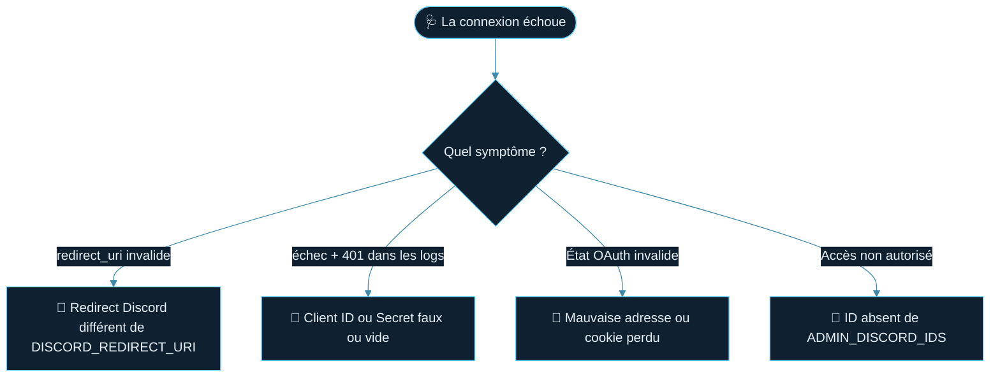

<!--built-->

  

  

📑 <b>Dans cette page</b> (8 sections)

- [🔐 Connexion Discord](#-connexion-discord)
- [💻 Démarrage local](#-démarrage-local)
- [☁️ Render](#-render)
- [🍪 Base de données](#-base-de-données)
- [🎞️ Médias](#-médias)
- [🖥️ Affichage](#-affichage)
- [🌿 Git](#-git)
- [❓ Questions fréquentes](#-questions-fréquentes)

## 🔐 Connexion Discord

> [!TIP]
> Avant tout : regarde les **logs** (terminal en local, onglet *Logs* sur Render). Le message exact indique presque toujours la cause.

| Symptôme | Cause | Solution |
|---|---|---|
| `Invalid OAuth2 redirect_uri` | Redirect Discord ≠ `DISCORD_REDIRECT_URI` | Identiques au caractère près (`http`/`https`, `/` final, `localhost`/`127.0.0.1`) |
| Logs : `401 … /oauth2/token`, `invalid_client` | Client ID/Secret faux ou vide | Reset Secret ; vérifier le nom `DISCORD_CLIENT_SECRET` |
| `400 État OAuth invalide` | Cookie de session perdu | Utiliser l'adresse exacte du redirect ; recommencer depuis « Accès éditeur » |
| « Accès non autorisé » | ID absent de la liste | Corriger `ADMIN_DISCORD_IDS` (virgules, sans espaces ni guillemets) |
| « Connexion Discord non configurée » | `DISCORD_CLIENT_ID` vide | Renseigner la variable, redémarrer |
| Déconnecté tout le temps | `FLASK_SECRET_KEY` changeante ou absente en local | Définir une clé fixe |

## 💻 Démarrage local
| Symptôme | Solution |
|---|---|
| `'SECTIONS' is undefined` | Importer les macros avec contexte : `` (déjà corrigé dans la dernière version) |
| `.env` sans effet | Fichier mal nommé (`.env.txt`) ou serveur non relancé |
| `ModuleNotFoundError` | `pip install -r requirements.txt` dans l'environnement virtuel activé |
| PowerShell bloque l'activation | `Set-ExecutionPolicy -Scope CurrentUser RemoteSigned` |
| Port déjà utilisé | Ferme l'autre instance ou définis `PORT=5001` (et adapte le redirect Discord) |

## ☁️ Render
| Symptôme | Cause / solution |
|---|---|
| Build échoue : module introuvable | Dépendance absente de `requirements.txt` |
| `RuntimeError: FLASK_SECRET_KEY doit être défini` | Ajouter la variable dans Environment |
| « No open ports detected » | La commande de démarrage doit contenir `--bind 0.0.0.0:$PORT` |
| `/healthz` ne répond pas | Voir les Logs ; vérifier `DATABASE_URL` |
| Site très lent au premier accès | Mise en veille de l'offre gratuite |
| Retour sur le site déconnecté après Discord | `DISCORD_REDIRECT_URI`/`SITE_URL` en `http` ou avec un autre domaine |
| Articles disparus après un déploiement | Base SQLite locale utilisée : définir `DATABASE_URL` |
| Images disparues après un déploiement | Disque local temporaire : utiliser R2/S3 ou un disque |

## 🍪 Base de données
Voir le tableau de la [page 6](06-Base-de-donnees.md) : adresse en Session pooler, mot de passe encodé, projet Supabase en pause, trop de connexions.
Erreur `Can't load plugin: sqlalchemy.dialects:postgresql.psycopg` → `psycopg[binary]` manquant dans `requirements.txt`.

## 🎞️ Médias
| Symptôme | Solution |
|---|---|
| « format non pris en charge » | Seuls PNG, JPG, GIF, WEBP, MP4, WEBM ; le contenu réel est vérifié |
| « fichier trop volumineux » / erreur 413 | Réduire le fichier ou augmenter `MAX_*_MB` (attention aux limites de l'hébergeur) |
| Vidéo noire / non lisible | Ré-encoder en H.264 + AAC |
| Image externe absente | Elle doit être en **https** |
| Média non affiché en S3/R2 | Bucket non public, `S3_PUBLIC_URL` faux, ou adresse avec `/` final |
| Shortcode affiché en texte | Il doit être **seul sur sa ligne** et commencer par `[[media:`, `[[gallery:` ou `[[youtube:` |

## 🖥️ Affichage
| Symptôme | Solution |
|---|---|
| Un script ou widget ajouté ne marche pas | La CSP bloque les scripts en ligne et les domaines non autorisés (voir [Personnalisation](12-Personnalisation.md)) |
| RSS/sitemap avec la mauvaise adresse | Définir `SITE_URL` |
| Animations absentes | Réglage « réduire les animations » du système, ou JavaScript bloqué |
| Texte qui ne s'habille pas autour du média | Utiliser `align=left` ou `right` ; sur mobile le média passe en pleine largeur |

## 🌿 Git
| Symptôme | Solution |
|---|---|
| `push` refusé (non-fast-forward) | `git pull --rebase` puis `git push` |
| `.env` apparaît dans `git status` | Vérifier `.gitignore` ; si déjà commité : `git rm --cached .env`, **puis reset des secrets** |
| Demande de mot de passe refusée | Utiliser un Personal Access Token |

## ❓ Questions fréquentes
**Faut-il un bot Discord ?** Non, seulement une application OAuth2.
**Plusieurs éditeurs ?** Oui : ajoute leurs ID, séparés par des virgules.
**Les articles de démonstration ?** Créés au premier démarrage d'une base vide ; supprime-les depuis le Studio.
**Puis-je héberger ailleurs que Render ?** Oui : tout hébergeur Python (commande `gunicorn app:app`, variables d'environnement identiques).
**Pourquoi pas GitHub Pages ?** Il ne sert que des fichiers statiques ; le site a besoin d'un serveur Python.

  

◀ <a href="12-Personnalisation.md">🎨 Personnalisation</a>&nbsp;&nbsp;·&nbsp;&nbsp;<a href="14-Maintenance.md">🔧 Maintenance</a> ▶

⛨ <b>SCP Foundation</b> — projet de fan non officiel · contenus SCP sous licence CC BY-SA 3.0 lorsque applicable · <a href="#">⬆ retour en haut</a>

