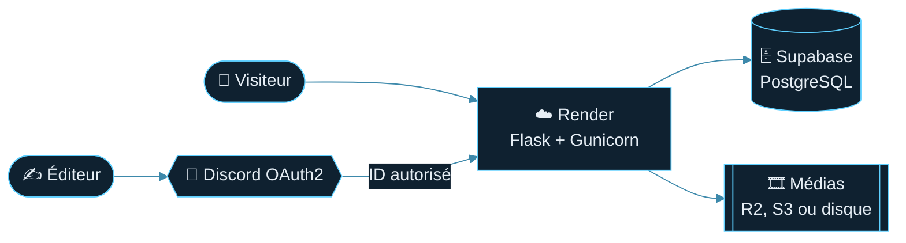

<!--built-->
<div align="center">



     

<br>

 &nbsp;  <b>Site en ligne</b> &nbsp;·&nbsp;  <b>14 pages de documentation</b>

<a href="01-Installation-locale.md"></a>

</div>

> [!TIP]
> **Première fois ?** Suis le parcours dans l'ordre : *Démarrer* → *Mettre en ligne* → *Publier*. Un problème ? Va directement au [🩺 Dépannage](13-Depannage.md).

<div align="center"></div>

## 🗺️ Sommaire

<table>
<tr><td colspan="3"><h3>🧭 Démarrer</h3></td></tr>
<tr>
<td width="33%" valign="top">

<a href="01-Installation-locale.md"><b>💻 01 · Installation locale</b></a><br><sub>Installer Python, lancer le site sur ton PC.</sub><br><sub>⏱ 10 min · 🎚 Débutant</sub>

</td>
<td width="33%" valign="top">

<a href="02-Configuration.md"><b>⚙️ 02 · Configuration</b></a><br><sub>Toutes les variables, leur rôle et leurs valeurs.</sub><br><sub>⏱ 10 min · 🎚 Débutant</sub>

</td>
<td width="33%" valign="top">

<a href="03-Discord-OAuth.md"><b>🔐 03 · Connexion Discord</b></a><br><sub>Créer l'application, le secret, les redirections.</sub><br><sub>⏱ 15 min · 🎚 Débutant</sub>

</td>
</tr>
<tr><td colspan="3"><h3>☁️ Mettre en ligne</h3></td></tr>
<tr>
<td width="33%" valign="top">

<a href="04-GitHub.md"><b>🐙 04 · GitHub</b></a><br><sub>Mettre le code en ligne et le mettre à jour.</sub><br><sub>⏱ 10 min · 🎚 Débutant</sub>

</td>
<td width="33%" valign="top">

<a href="05-Render.md"><b>🚀 05 · Déploiement Render</b></a><br><sub>Héberger le site, domaine, logs, limites.</sub><br><sub>⏱ 20 min · 🎚 Intermédiaire</sub>

</td>
<td width="33%" valign="top">

<a href="06-Base-de-donnees.md"><b>🗄️ 06 · Base de données</b></a><br><sub>Supabase, Session pooler, schéma, sauvegardes.</sub><br><sub>⏱ 15 min · 🎚 Intermédiaire</sub>

</td>
</tr>
<tr>
<td width="33%" valign="top">

<a href="07-Medias.md"><b>🎞️ 07 · Médias et stockage</b></a><br><sub>Images et vidéos durables avec R2 / S3.</sub><br><sub>⏱ 20 min · 🎚 Intermédiaire</sub>

</td>
<td></td>
<td></td>
</tr>
<tr><td colspan="3"><h3>✍️ Publier & gérer</h3></td></tr>
<tr>
<td width="33%" valign="top">

<a href="08-Rediger.md"><b>✍️ 08 · Rédiger un article</b></a><br><sub>Markdown, médias placés où tu veux, aperçu.</sub><br><sub>⏱ 10 min · 🎚 Débutant</sub>

</td>
<td width="33%" valign="top">

<a href="09-Administration.md"><b>🛠️ 09 · Administration</b></a><br><sub>Studio, brouillons, publication, suppression.</sub><br><sub>⏱ 5 min · 🎚 Débutant</sub>

</td>
<td width="33%" valign="top">

<a href="12-Personnalisation.md"><b>🎨 12 · Personnalisation</b></a><br><sub>Adapter le nom, les départements, le thème.</sub><br><sub>⏱ 15 min · 🎚 Intermédiaire</sub>

</td>
</tr>
<tr><td colspan="3"><h3>🛡️ Fiabilité & évolution</h3></td></tr>
<tr>
<td width="33%" valign="top">

<a href="10-Securite.md"><b>🛡️ 10 · Sécurité</b></a><br><sub>Ce qui est protégé et ce qu'il te reste à faire.</sub><br><sub>⏱ 10 min · 🎚 Tous niveaux</sub>

</td>
<td width="33%" valign="top">

<a href="11-Architecture.md"><b>🧬 11 · Architecture</b></a><br><sub>Comment le code est organisé.</sub><br><sub>⏱ 15 min · 🎚 Avancé</sub>

</td>
<td width="33%" valign="top">

<a href="13-Depannage.md"><b>🩺 13 · Dépannage / FAQ</b></a><br><sub>Un symptôme, une cause, une solution.</sub><br><sub>⏱ au besoin · 🎚 Tous niveaux</sub>

</td>
</tr>
<tr>
<td width="33%" valign="top">

<a href="14-Maintenance.md"><b>🔧 14 · Maintenance</b></a><br><sub>Faire durer et grandir le site.</sub><br><sub>⏱ 15 min · 🎚 Intermédiaire</sub>

</td>
<td></td>
<td></td>
</tr>
</table>

## 🧭 Le parcours en un coup d'œil

```mermaid
%%{init: {"theme":"base","themeVariables":{"primaryColor":"#0f2130","primaryTextColor":"#e6eef5","primaryBorderColor":"#5fd0ff","lineColor":"#3d89ab","secondaryColor":"#1a0d14","tertiaryColor":"#0b1824","edgeLabelBackground":"#0f2130","fontFamily":"ui-monospace, Menlo, Consolas, monospace","noteBkgColor":"#1a0d14","noteTextColor":"#ffb4bb","actorBkg":"#0f2130","actorBorder":"#5fd0ff","actorTextColor":"#e6eef5","signalColor":"#3d89ab","signalTextColor":"#3d89ab","labelBoxBkgColor":"#0f2130","labelTextColor":"#e6eef5","loopTextColor":"#3d89ab"}}}%%
flowchart LR
  subgraph L["🧭 1 · En local"]
    A["💻 Installer"] --> B["⚙️ Configurer"] --> C["🔐 Discord"]
  end
  subgraph W["☁️ 2 · En ligne"]
    D["🐙 GitHub"] --> E["🗄️ Base"] --> F["🚀 Render"] --> G["🎞️ Médias"]
  end
  subgraph P["✍️ 3 · Au quotidien"]
    H["✍️ Rédiger"] --> I["🛠️ Administrer"] --> J["🔧 Maintenir"]
  end
  C --> D
  G --> H
```



## 🏗️ Vue d'ensemble



## 💶 Coûts (option gratuite)

| Brique | Option gratuite | Limites habituelles |
|---|---|---|
| 🐙 Code | GitHub (dépôt privé ou public) | — |
| ☁️ Hébergement | Render « Free » | veille après inactivité, démarrage lent, pas de disque |
| 🗄️ Base | Supabase « Free » | projet pouvant être mis en pause, stockage limité |
| 🎞️ Médias | Cloudflare R2 (offre gratuite) | quota gratuit limité |
| 🔐 Identification | Discord OAuth2 | gratuit |

> [!NOTE]
> Tarifs et limites **évoluent** : vérifie toujours les pages officielles de chaque service.

## 🧰 Aide-mémoire

<details open>
<summary><b>Commandes essentielles</b></summary>

```powershell
# Lancer en local
.\.venv\Scripts\Activate.ps1 ; python app.py

# Envoyer une mise à jour (Render redéploie seul)
git add . ; git commit -m "message" ; git push

# Clé secrète aléatoire
python -c "import secrets; print(secrets.token_hex(32))"

# Sauvegarde de la base
pg_dump "<adresse Supabase>" -f sauvegarde.sql
```

</details>

## ❓ Questions rapides

| ❓ Question | 👉 Réponse |
|---|---|
| Faut-il un bot Discord ? | Non, juste une application OAuth2 → [page 3](03-Discord-OAuth.md) |
| Plusieurs éditeurs ? | Oui, liste d'ID séparés par des virgules → [page 9](09-Administration.md) |
| Mes images disparaissent | Stockage temporaire → [page 7](07-Medias.md) |
| Erreur à la connexion | [Arbre de diagnostic](13-Depannage.md) |
| Ajouter un département | [Personnalisation](12-Personnalisation.md) |

<div align="center">


<a href="01-Installation-locale.md"></a>


<sub>⛨ <b>SCP Foundation</b> — projet de fan non officiel · contenus SCP sous licence CC BY-SA 3.0 lorsque applicable</sub>

</div>
