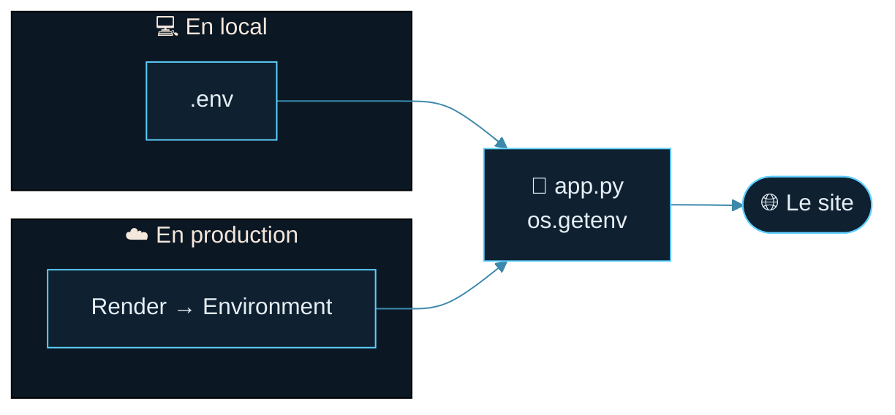

<div align="center">



  

<a href="01-Installation-locale"></a> <a href="Home"></a> <a href="03-Discord-OAuth"></a>

</div>

<details>
<summary>📑 <b>Dans cette page</b> (6 sections)</summary>

- [🔴 Obligatoires](#-obligatoires)
- [🏭 Production](#-production)
- [🎞️ Médias](#-médias)
- [🧪 Avancé](#-avancé)
- [🧾 Modèle `.env` local](#-modèle-env-local)
- [📏 Règles d'écriture](#-règles-décriture)

</details>

Le site se configure uniquement par variables d'environnement : fichier `.env` en local, onglet **Environment** sur Render. **Ne publie jamais `.env`** (il est dans `.gitignore`).

## 🔴 Obligatoires

> [!CAUTION]
> **Ne publie jamais le fichier `.env`** ni ces valeurs dans un message, un dépôt ou une capture d'écran.


| Variable | Rôle | Exemple |
|---|---|---|
| `FLASK_SECRET_KEY` | Signe les sessions et jetons CSRF. Longue valeur aléatoire, **stable**. Sur Render, le site refuse de démarrer sans elle. | voir ci-dessous |
| `DISCORD_CLIENT_ID` | Identifiant de l'application Discord | `1562064266721361930` |
| `DISCORD_CLIENT_SECRET` | Secret OAuth2 (≈ 32 caractères) | — |
| `DISCORD_REDIRECT_URI` | Adresse de retour, identique à celle du portail Discord | `https://mon-site.onrender.com/auth/callback` |
| `ADMIN_DISCORD_IDS` | ID Discord autorisés à publier, séparés par des virgules | `123456789012345678,987654321098765432` |

Générer une clé secrète :
```powershell
python -c "import secrets; print(secrets.token_hex(32))"
```

## 🏭 Production




| Variable | Rôle | Défaut |
|---|---|---|
| `DATABASE_URL` | Adresse PostgreSQL (Supabase…). `postgres://` et `postgresql://` sont acceptés. | SQLite locale |
| `SITE_URL` | Adresse publique (RSS, sitemap, robots.txt), sans `/` final | déduite de la requête |
| `SITE_NAME` | Nom affiché | `SCP Foundation` |
| `PYTHON_VERSION` | Version Python utilisée par Render | — (ex. `3.12.7`) |
| `RENDER` | Définie **automatiquement** par Render : active cookies sécurisés et HSTS | — |

## 🎞️ Médias

| Variable | Rôle | Défaut |
|---|---|---|
| `DATA_DIR` | Dossier de stockage (base SQLite + `uploads/`). Pour un disque Render : `/var/data` | dossier du projet |
| `MAX_IMAGE_MB` | Taille max d'une image | `12` |
| `MAX_VIDEO_MB` | Taille max d'une vidéo | `80` |
| `S3_BUCKET` | Active le stockage S3/R2 si défini | — |
| `S3_ENDPOINT_URL` | Endpoint S3 (R2 : `https://<ACCOUNT_ID>.r2.cloudflarestorage.com`) | — |
| `S3_PUBLIC_URL` | Adresse publique du bucket (sans `/` final) | — |
| `S3_ACCESS_KEY_ID` / `S3_SECRET_ACCESS_KEY` | Clés d'accès | — |
| `S3_REGION` | Région | `auto` |

## 🧪 Avancé

| Variable | Rôle | Défaut |
|---|---|---|
| `RATELIMIT_STORAGE_URI` | Compteurs de limitation partagés (ex. `redis://…`) | mémoire (par worker) |
| `PORT` | Port local (`python app.py`) | `5000` |
| `FLASK_DEBUG` | `1` = mode debug **local uniquement** | `0` |

## 🧾 Modèle `.env` local

```
FLASK_SECRET_KEY=colle-ici-une-valeur-aleatoire
DISCORD_CLIENT_ID=123456789012345678
DISCORD_CLIENT_SECRET=secret_sans_guillemets
DISCORD_REDIRECT_URI=http://127.0.0.1:5000/auth/callback
ADMIN_DISCORD_IDS=123456789012345678
```

## 📏 Règles d'écriture
- Une variable par ligne, **sans guillemets ni espaces** autour du `=`.
- Pas de `#` dans une valeur (le reste de la ligne serait ignoré).
- Après toute modification : redémarrer le serveur (en local) ; Render redéploie seul.

<div align="center">


<a href="01-Installation-locale"></a> <a href="Home"></a> <a href="03-Discord-OAuth"></a>

<sub>◀ <a href="01-Installation-locale">💻 Installation locale</a>&nbsp;&nbsp;·&nbsp;&nbsp;<a href="03-Discord-OAuth">🔐 Connexion Discord</a> ▶</sub>


<sub>⛨ <b>SCP Foundation</b> — projet de fan non officiel · contenus SCP sous licence CC BY-SA 3.0 lorsque applicable · <a href="#">⬆ retour en haut</a></sub>

</div>
