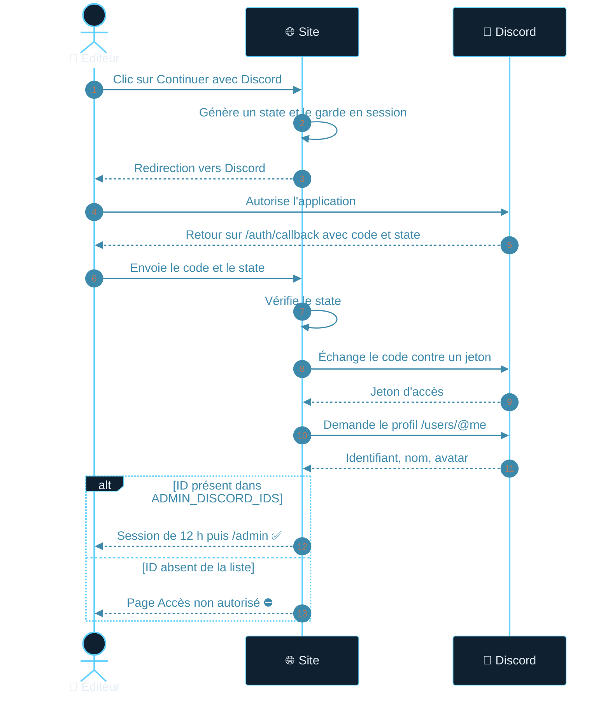

<div align="center">



  

<a href="02-Configuration"></a> <a href="Home"></a> <a href="04-GitHub"></a>

</div>

<details>
<summary>📑 <b>Dans cette page</b> (9 sections)</summary>

- [🆕 Créer l'application](#-créer-lapplication)
- [🔑 Récupérer les identifiants (menu **OAuth2**)](#-récupérer-les-identifiants-menu-oauth2)
- [📍 Déclarer les redirections (OAuth2 → Redirects)](#-déclarer-les-redirections-oauth2--redirects)
- [🪪 Obtenir un ID utilisateur](#-obtenir-un-id-utilisateur)
- [📝 Renseigner le site](#-renseigner-le-site)
- [🔄 Déroulement de la connexion](#-déroulement-de-la-connexion)
- [👥 Ajouter / retirer un éditeur](#-ajouter--retirer-un-éditeur)
- [🧯 Erreurs courantes](#-erreurs-courantes)
- [🛡️ Sécurité du secret](#-sécurité-du-secret)

</details>

Le site utilise **OAuth2 uniquement pour identifier** l'utilisateur (scope `identify`). **Aucun bot n'est nécessaire.** Seuls les ID listés dans `ADMIN_DISCORD_IDS` accèdent au studio ; la liste est revérifiée à chaque requête d'administration.

## 🆕 Créer l'application
1. Ouvre le [Discord Developer Portal](https://discord.com/developers/applications) → **New Application**.
2. Le nom choisi s'affiche sur l'écran d'autorisation vu par les éditeurs.

## 🔑 Récupérer les identifiants (menu **OAuth2**)

> [!WARNING]
> Le **Client Secret** n'est affiché qu'**une seule fois**. Chaque clic sur *Reset Secret* invalide l'ancien : recopie-le tout de suite dans `DISCORD_CLIENT_SECRET`.

- **Client ID** : à copier.
- **Client Secret** : bouton **Reset Secret**, puis copie **immédiatement** (affiché une seule fois). Chaque reset invalide l'ancien.

## 📍 Déclarer les redirections (OAuth2 → Redirects)
Ajoute **exactement** (caractère pour caractère) :

| Contexte | Redirect URI |
|---|---|
| Local | `http://127.0.0.1:5000/auth/callback` |
| Production | `https://TON-SERVICE.onrender.com/auth/callback` (ou ton domaine) |

Puis **Save Changes**. Les deux peuvent coexister. `localhost` ≠ `127.0.0.1`, `http` ≠ `https`, et un `/` final change l'adresse.

## 🪪 Obtenir un ID utilisateur
Discord → Paramètres → Avancés → **Mode développeur** → clic droit sur un profil → **Copier l'identifiant utilisateur** (17 à 19 chiffres).

## 📝 Renseigner le site
```
DISCORD_CLIENT_ID=...
DISCORD_CLIENT_SECRET=...
DISCORD_REDIRECT_URI=<identique à celle du portail>
ADMIN_DISCORD_IDS=ID1,ID2,ID3
```

## 🔄 Déroulement de la connexion



1. `/login` affiche la page d'accès ; le bouton mène à `/login?go=1`.
2. Le site génère un `state` anti-falsification, stocké en session, et redirige vers Discord.
3. Discord renvoie sur `/auth/callback?code=…&state=…`.
4. Le serveur vérifie le `state`, échange le `code` contre un jeton, lit le profil (`/users/@me`).
5. Si l'ID est dans la liste : nouvelle session (12 h) → `/admin`. Sinon : page « Accès non autorisé ».

## 👥 Ajouter / retirer un éditeur
Modifie `ADMIN_DISCORD_IDS` (Render → Environment) puis enregistre : le site redémarre. Un ID retiré perd l'accès **immédiatement**, même s'il était connecté.

## 🧯 Erreurs courantes
| Message / symptôme | Cause | Solution |
|---|---|---|
| `Invalid OAuth2 redirect_uri` (page Discord) | Redirect du portail ≠ `DISCORD_REDIRECT_URI` | Les rendre identiques au caractère près |
| Logs : `401 … oauth2/token` / `invalid_client` | Client ID ou Secret faux ou **vide** | Reset Secret, recopier, vérifier le nom `DISCORD_CLIENT_SECRET` |
| `400 État OAuth invalide` | Cookie de session perdu (mélange `localhost`/`127.0.0.1`, onglet périmé) | Ouvrir le site sur l'adresse exacte du redirect, recommencer depuis « Accès éditeur » |
| Page « Accès non autorisé » | Connexion OK mais ID absent de la liste | Corriger `ADMIN_DISCORD_IDS` (virgules, sans espaces ni guillemets) |
| « Connexion Discord non configurée » | `DISCORD_CLIENT_ID` vide | Renseigner la variable, redémarrer |
| Connexion OK mais retour déconnecté en production | `FLASK_SECRET_KEY` instable ou cookies bloqués | Fixer une clé stable ; utiliser HTTPS |

## 🛡️ Sécurité du secret
Ne colle jamais le Client Secret dans un message, un dépôt ou une capture. S'il fuite : **Reset Secret** immédiatement et mets à jour la variable.

<div align="center">


<a href="02-Configuration"></a> <a href="Home"></a> <a href="04-GitHub"></a>

<sub>◀ <a href="02-Configuration">⚙️ Configuration</a>&nbsp;&nbsp;·&nbsp;&nbsp;<a href="04-GitHub">🐙 GitHub</a> ▶</sub>


<sub>⛨ <b>SCP Foundation</b> — projet de fan non officiel · contenus SCP sous licence CC BY-SA 3.0 lorsque applicable · <a href="#">⬆ retour en haut</a></sub>

</div>
