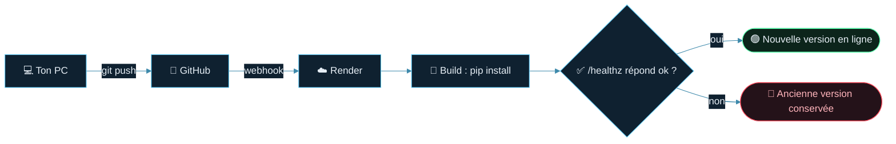

<div align="center">



  

<a href="03-Discord-OAuth"></a> <a href="Home"></a> <a href="05-Render"></a>

</div>

<details>
<summary>📑 <b>Dans cette page</b> (7 sections)</summary>

- [🧰 Avant le premier envoi](#-avant-le-premier-envoi)
- [🆕 Créer le dépôt](#-créer-le-dépôt)
- [📤 Premier envoi](#-premier-envoi)
- [♻️ Mettre à jour le site](#-mettre-à-jour-le-site)
- [🚨 Si un secret a été publié par erreur](#-si-un-secret-a-été-publié-par-erreur)
- [✅ Bonnes pratiques](#-bonnes-pratiques)
- [📚 Utiliser GitHub comme wiki gratuit](#-utiliser-github-comme-wiki-gratuit)

</details>

GitHub **stocke le code** ; il n'héberge pas le site (GitHub Pages ne gère que le statique). C'est Render qui exécute le site à partir de ton dépôt.

## 🧰 Avant le premier envoi
- Vérifie que `.gitignore` contient `.env`, `.venv/`, `uploads/*`, `scp_site.db*`.
- Ne mets **jamais** de secret dans le code.

## 🆕 Créer le dépôt
github.com → **New repository** → nom `scp-foundation`, **Private** recommandé, **sans** README ni .gitignore initiaux.

## 📤 Premier envoi
```powershell
cd "C:\chemin\vers\scp_public"
git init
git add .
git status          # .env et .venv NE DOIVENT PAS apparaître
git commit -m "Version publique"
git branch -M main
git remote add origin https://github.com/TON-PSEUDO/scp-foundation.git
git push -u origin main
```
Au premier `push`, une fenêtre d'authentification GitHub s'ouvre. En cas de refus, crée un **Personal Access Token** (Settings → Developer settings) et utilise-le comme mot de passe.

## ♻️ Mettre à jour le site



```powershell
git add .
git commit -m "Description du changement"
git push
```
Si Render est en déploiement automatique, chaque `push` sur `main` redéploie le site.

## 🚨 Si un secret a été publié par erreur

> [!CAUTION]
> Un secret poussé sur GitHub doit être considéré comme **compromis**, même dans un dépôt privé : fais d'abord un *Reset*, nettoie ensuite.

1. **Reset** immédiat du secret concerné (Discord, mot de passe Supabase, clés R2).
2. Retire-le de l'historique si possible (`git filter-repo`) ou recrée le dépôt.
3. Un secret poussé est **compromis**, même dans un dépôt privé.

## ✅ Bonnes pratiques
- Messages de commit clairs, un changement logique par commit.
- Branche `dev` pour les essais, fusion dans `main` quand c'est stable.
- Ne versionne ni les médias ni la base.

## 📚 Utiliser GitHub comme wiki gratuit
- **Option 1 (recommandée)** : garder le dossier `docs/` dans le dépôt (liens relatifs `.md` prêts).
- **Option 2 — Wiki GitHub** : le dossier **`wiki/`** est déjà prêt (liens sans `.md`, barre latérale `_Sidebar.md`, pied de page `_Footer.md`, images dans `assets/`).
  1. Sur GitHub, onglet **Wiki** → crée une première page vide (cela initialise le wiki).
  2. Clone-le : `git clone https://github.com/TON-PSEUDO/scp-foundation.wiki.git`
  3. Copie **tout le contenu** du dossier `wiki/` dedans, puis `git add . ; git commit -m "Wiki" ; git push`.

  Les bannières et boutons animés sont des fichiers SVG : si une image ne s'affichait pas dans le wiki, passe par l'option 1 (dossier `docs/`), qui fonctionne partout.

<div align="center">


<a href="03-Discord-OAuth"></a> <a href="Home"></a> <a href="05-Render"></a>

<sub>◀ <a href="03-Discord-OAuth">🔐 Connexion Discord</a>&nbsp;&nbsp;·&nbsp;&nbsp;<a href="05-Render">🚀 Déploiement Render</a> ▶</sub>


<sub>⛨ <b>SCP Foundation</b> — projet de fan non officiel · contenus SCP sous licence CC BY-SA 3.0 lorsque applicable · <a href="#">⬆ retour en haut</a></sub>

</div>
