<div align="center">



  

<a href="07-Medias"></a> <a href="Home"></a> <a href="09-Administration"></a>

</div>

<details>
<summary>📑 <b>Dans cette page</b> (5 sections)</summary>

- [✒️ Markdown pris en charge](#-markdown-pris-en-charge)
- [🎞️ Insérer des médias](#-insérer-des-médias)
- [🖥️ Dans l'éditeur](#-dans-léditeur)
- [🏷️ Résumé, tags, couverture](#-résumé-tags-couverture)
- [⚠️ Limites connues](#-limites-connues)

</details>

Studio → **Nouveau document**. Titre, département, tags, résumé, couverture, contenu, puis cases **Publier** / **Épingler**.

## ✒️ Markdown pris en charge
| Syntaxe | Résultat |
|---|---|
| `## Titre` / `### Sous-titre` | Titres (alimentent le **sommaire automatique**) |
| `**gras**`, `*italique*` | **Gras**, *italique* (le barré `~~` n'existe pas : utilise `<del>texte</del>`) |
| `> citation` | Bloc citation rouge |
| `- élément` / `1. élément` | Listes |
| `` `code` `` et blocs ``` ``` ``` | Code |
| `[texte](https://…)` | Lien (s'ouvre dans un nouvel onglet) |
| Tableaux `\| a \| b \|` | Tableaux |
| `\|\|texte\|\|` | **Texte expurgé** : barre noire, révélée au survol ou au clic |

Le HTML saisi à la main est **assaini** : seules les balises de mise en forme courantes sont conservées (scripts, styles, iframes arbitraires supprimés).

## 🎞️ Insérer des médias

```mermaid
%%{init: {"theme":"base","themeVariables":{"primaryColor":"#0f2130","primaryTextColor":"#e6eef5","primaryBorderColor":"#5fd0ff","lineColor":"#3d89ab","secondaryColor":"#1a0d14","tertiaryColor":"#0b1824","edgeLabelBackground":"#0f2130","fontFamily":"ui-monospace, Menlo, Consolas, monospace","noteBkgColor":"#1a0d14","noteTextColor":"#ffb4bb","actorBkg":"#0f2130","actorBorder":"#5fd0ff","actorTextColor":"#e6eef5","signalColor":"#3d89ab","signalTextColor":"#3d89ab","labelBoxBkgColor":"#0f2130","labelTextColor":"#e6eef5","loopTextColor":"#3d89ab"}}}%%
flowchart LR
  A["📝 Markdown + shortcodes"] --> B["🧩 Extraction des shortcodes"]
  B --> C["█ Texte expurgé en span"]
  C --> D["📄 Markdown vers HTML"]
  D --> E["🧼 bleach : assainissement"]
  E --> F["🖼️ Réinsertion des médias"]
  F --> G(["🌐 Page publiée"])
  class G ok
  classDef cloud fill:#0f2130,stroke:#5fd0ff,color:#e6eef5
  classDef ok fill:#0c241b,stroke:#5dffb0,color:#e6eef5
  classDef bad fill:#241219,stroke:#ff4d5e,color:#ffb4bb
```



**Aperçu des dispositions :**

```text
 align=left            align=right           align=center / full
┌──────┬───────────┐   ┌───────────┬──────┐   ┌──────────────────┐
│ IMG  │ texte qui │   │ texte qui │ IMG  │   │ texte            │
│      │ habille   │   │ habille   │      │   ├──────────────────┤
├──────┘ le média  │   │ le média  └──────┤   │       IMG        │
│ suite du texte   │   │ suite du texte   │   ├──────────────────┤
└──────────────────┘   └──────────────────┘   │ texte            │
                                              └──────────────────┘
```

Un shortcode se place **seul sur sa ligne**, n'importe où : avant, après ou entre des paragraphes.

```
[[media: URL | align=left | width=40 | caption=Légende]]
```

| Option | Valeurs | Effet |
|---|---|---|
| `align` | `full` (défaut), `center`, `left`, `right` | `left`/`right` : le texte suivant habille le média ; `center`/`full` : seul sur sa ligne |
| `width` | 10 à 100 | Largeur en % de la colonne |
| `caption` | texte | Légende (sans `\|` ni `]`) |
| `loop` | drapeau (vidéo) | Lecture automatique, muette, en boucle (façon GIF) |

### Autres blocs
```
[[media: https://exemple.com/video.mp4 | loop]]
[[gallery: URL1 | URL2 | URL3]]
[[youtube: https://youtu.be/dQw4w9WgXcQ]]
```
- `gallery` : grille responsive d'images/vidéos.
- `youtube` : accepte un lien (`youtu.be`, `watch?v=`, `embed/`) ou l'identifiant de 11 caractères ; lecture via `youtube-nocookie.com`.
- Les adresses acceptées : fichiers de la bibliothèque (`/media/…` ou adresse du bucket) ou n'importe quelle adresse **https**. Les autres (`http`, `javascript:`…) sont ignorées.
- Une vidéo est reconnue à l'extension `.mp4`, `.webm`, `.mov` ; le reste est traité comme image.

### Exemple
```
## Observation

[[media: /media/a1b2c3.jpg | align=right | width=40 | caption=Sujet à 14h02]]

Le sujet est resté immobile pendant toute la durée de l'observation. Le texte
continue autour de l'image placée à droite.

[[gallery: /media/x.jpg | /media/y.jpg | /media/z.jpg]]

Les données ont été ||expurgées|| par ordre du directeur.
```

## 🖥️ Dans l'éditeur
- **Bibliothèque** à droite : glisse-dépose, clic pour parcourir, ou **colle une image** (Ctrl+V) dans le texte.
- Choisis disposition, largeur, légende, puis **Insérer** : le shortcode est ajouté à la position du curseur.
- **Couverture** : définit l'image affichée en tête d'article et sur les cartes.
- **Sélection** de plusieurs médias puis **Insérer en galerie**.
- **Aperçu** en direct (bouton 👁), compteur de mots, **brouillon local** sauvegardé dans ton navigateur (bouton de restauration si la page est rechargée).

## 🏷️ Résumé, tags, couverture
- **Résumé** : 300 caractères max ; généré automatiquement à partir du texte si laissé vide.
- **Tags** : séparés par des virgules ; transformés en `minuscules-sans-accents` (8 max). Chaque tag a sa page `/tag/<tag>`.
- **Couverture** : image (ou adresse https) ; sans couverture, une icône de département s'affiche.

## ⚠️ Limites connues

> [!NOTE]
> Les légendes sont du **texte brut**. L'adresse d'un article est créée à partir du titre **au moment de la création**.

- Un shortcode écrit **dans un bloc de code** est quand même interprété. Pour l'afficher tel quel, écris-le avec un espace : `[ [media: …] ]`.
- Les légendes sont du texte brut.
- Le titre d'article génère l'adresse (`/a/<slug>`) à la **création** ; modifier le titre ensuite ne change pas l'adresse.

<div align="center">


<a href="07-Medias"></a> <a href="Home"></a> <a href="09-Administration"></a>

<sub>◀ <a href="07-Medias">🎞️ Médias et stockage</a>&nbsp;&nbsp;·&nbsp;&nbsp;<a href="09-Administration">🛠️ Administration</a> ▶</sub>


<sub>⛨ <b>SCP Foundation</b> — projet de fan non officiel · contenus SCP sous licence CC BY-SA 3.0 lorsque applicable · <a href="#">⬆ retour en haut</a></sub>

</div>
