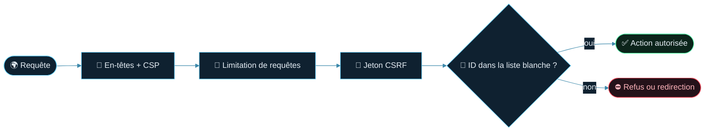

  

  

📑 <b>Dans cette page</b> (5 sections)

- [🔒 Protections intégrées](#-protections-intégrées)
- [📌 À faire de ton côté](#-à-faire-de-ton-côté)
- [⚠️ Limites à connaître](#-limites-à-connaître)
- [🍪 Données personnelles (information, pas un avis juridique)](#-données-personnelles-information-pas-un-avis-juridique)
- [📣 Signaler une faille](#-signaler-une-faille)

## 🔒 Protections intégrées

| Protection | Détail |
|---|---|
| **Liste blanche d'éditeurs** | ID Discord vérifié à **chaque** requête d'administration |
| **OAuth2 avec `state`** | Anti-falsification de la connexion ; session renouvelée après connexion |
| **CSRF** | Jeton obligatoire sur tous les envois (formulaires et requêtes de l'éditeur) |
| **Cookies de session** | `HttpOnly`, `SameSite=Lax`, `Secure` sur Render, durée 12 h |
| **HTML assaini** | Contenu passé par `bleach` : pas de script, style ni iframe arbitraire |
| **Politique CSP stricte** | Aucun script en ligne ; seuls les scripts du site ; iframes limitées à YouTube (nocookie) |
| **En-têtes** | `X-Frame-Options: DENY`, `nosniff`, `Referrer-Policy`, `Permissions-Policy`, HSTS sur Render |
| **Envois de fichiers** | Signature réelle vérifiée, types restreints, noms aléatoires, tailles plafonnées, SVG refusé |
| **Limitation de requêtes** | 600/min par IP en général ; 20/min sur la connexion ; 60/min sur l'envoi de médias |
| **Admin non indexée** | `noindex`, `no-store`, exclue par `robots.txt` |
| **Requêtes SQL paramétrées** | SQLAlchemy ; recherche avec échappement des jokers |

## 📌 À faire de ton côté

> [!IMPORTANT]
> Active la **double authentification** sur chaque compte Discord éditeur et garde la liste `ADMIN_DISCORD_IDS` la plus courte possible.

- **Secrets** : jamais dans Git. En cas de fuite : Reset immédiat (Discord, Supabase, R2).
- **Dépôt GitHub privé**.
- **Compte Discord des éditeurs** : active la double authentification.
- **Liste d'ID minimale** et revue régulière.
- **HTTPS** uniquement (automatique sur Render).
- **Mises à jour** des dépendances ([page 14](14-Maintenance)).

## ⚠️ Limites à connaître
- Tous les éditeurs sont **équivalents** (pas de rôles, pas de journal d'audit).
- La limitation de requêtes est comptée **par worker** (mémoire) ; pour un compteur partagé, configure `RATELIMIT_STORAGE_URI` (Redis).
- Les médias sont **publics** par adresse (adresses non devinables, mais non protégées).
- Un shortcode `[[media: https://…]]` peut charger une image hébergée ailleurs (le navigateur du visiteur contacte ce site tiers).

## 🍪 Données personnelles (information, pas un avis juridique)
- Pour les visiteurs : aucun compte, aucun traceur ajouté ; polices chargées depuis Google Fonts.
- Pour les éditeurs : l'ID et le nom Discord sont conservés dans le **cookie de session** ; le **nom** de l'auteur est enregistré avec chaque document.
- Un site public en France peut nécessiter des **mentions légales** (éditeur/hébergeur) et une information sur les cookies strictement nécessaires : rédige-les selon ta situation.

## 📣 Signaler une faille
Ajoute un fichier `SECURITY.md` à ton dépôt indiquant un contact privé pour les signalements.

  

◀ <a href="09-Administration">🛠️ Administration</a>&nbsp;&nbsp;·&nbsp;&nbsp;<a href="11-Architecture">🧬 Architecture</a> ▶

⛨ <b>SCP Foundation</b> — projet de fan non officiel · contenus SCP sous licence CC BY-SA 3.0 lorsque applicable · <a href="#">⬆ retour en haut</a>

