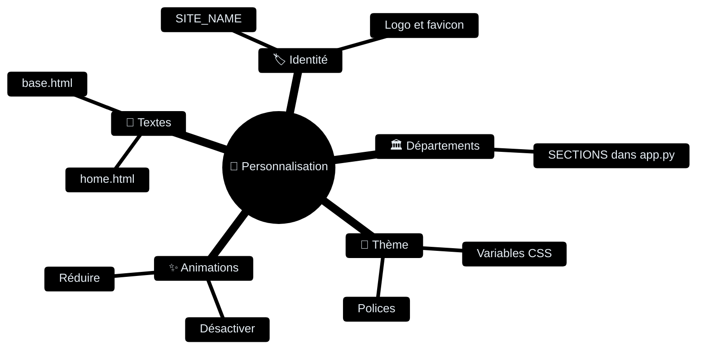

<div align="center">



  

<a href="11-Architecture"></a> <a href="Home"></a> <a href="13-Depannage"></a>

</div>

<details>
<summary>📑 <b>Dans cette page</b> (10 sections)</summary>

- [🏷️ Nom du site](#-nom-du-site)
- [🏛️ Départements](#-départements)
- [🎨 Couleurs et polices](#-couleurs-et-polices)
- [📝 Textes de l'accueil](#-textes-de-laccueil)
- [✨ Animations](#-animations)
- [⚠️ Pagination et limites](#-pagination-et-limites)
- [🖼️ Logo / favicon](#-logo--favicon)
- [🌍 Langue](#-langue)
- [📄 Ajouter une page (exemple « À propos »)](#-ajouter-une-page-exemple--à-propos-)
- [🧱 Content-Security-Policy](#-content-security-policy)

</details>

## 🏷️ Nom du site



Variable `SITE_NAME` (titre, en-tête, flux RSS). Les textes fixes (slogan, pied de page) sont dans `templates/base.html`.

## 🏛️ Départements
Dans `app.py`, dictionnaire `SECTIONS` :
```python
SECTIONS = {
    "dossiers-scp": {"label": "Dossiers SCP", "icon": "◉", "desc": "Entités, objets et phénomènes anormaux."},
    ...
}
```
- **Ajouter** : nouvelle entrée (clé = slug en minuscules sans espaces). Aucune autre modification : menu, accueil, filtres et éditeur s'adaptent. La grille de l'accueil est prévue pour 5 colonnes (voir `.dept-grid` dans le CSS).
- **Renommer le libellé** : change `label`.
- **Changer une clé existante** : mets à jour la base : `UPDATE posts SET section='nouvelle-cle' WHERE section='ancienne-cle';` (éditeur SQL de Supabase).
- **Supprimer** : ne supprime pas une clé utilisée par des articles (ils feraient planter l'affichage) ; déplace-les d'abord.

## 🎨 Couleurs et polices
`static/css/style.css`, bloc `:root` :
```css
--bg:#05080d; --cyan:#5fd0ff; --red:#ff4d5e; --green:#5dffb0; --amber:#ffb347;
```
Polices : liens Google Fonts dans `templates/base.html` + variables `--sans`, `--mono`, `--disp`.

## 📝 Textes de l'accueil
`templates/home.html` : titre du héros, accroche, lignes de la séquence de démarrage (`data-line`), bandeau défilant (`.ticker`), citation, alerte de sécurité.

## ✨ Animations
- **Tout désactiver** : supprime les `<div class="noise">`, `<div class="scan">` de `base.html` et l'élément `<canvas id="static">` de `home.html`.
- **Réduire** : baisse `opacity` de `.noise`, la vitesse de `.ticker div` (durée de `marquee`), ou retire `data-tilt` des cartes.
- Les visiteurs ayant réglé leur système sur « réduire les animations » n'en voient aucune.

## ⚠️ Pagination et limites
- `PER_PAGE` (12) dans `app.py`.
- Limites de requêtes : `default_limits` et décorateurs `@limiter.limit(...)`.
- Tailles de médias : `MAX_IMAGE_MB`, `MAX_VIDEO_MB`.

## 🖼️ Logo / favicon
Le logo est un caractère (⛨) dans `.brand-mark`. Pour une image, remplace ce `<span>` par `` et ajuste le CSS. Le favicon est défini dans `base.html`.

## 🌍 Langue
Les textes sont en français dans les templates et dans `app.py` (messages d'erreur, `flash`). Les dates utilisent le format `jj/mm/aaaa` (filtre `fdate`).

## 📄 Ajouter une page (exemple « À propos »)
```python
@app.route("/a-propos")
def about():
    return render_template("about.html")
```
Puis crée `templates/about.html` (``) et ajoute un lien dans la navigation de `base.html`. Ajoute la page au sitemap si besoin.

## 🧱 Content-Security-Policy
Si tu ajoutes un service externe (statistiques, polices, widgets), autorise son domaine dans l'en-tête `Content-Security-Policy` de la fonction `headers()` de `app.py`. **Pas de script en ligne** : place le JavaScript dans `static/js/`.

<div align="center">


<a href="11-Architecture"></a> <a href="Home"></a> <a href="13-Depannage"></a>

<sub>◀ <a href="11-Architecture">🧬 Architecture</a>&nbsp;&nbsp;·&nbsp;&nbsp;<a href="13-Depannage">🩺 Dépannage / FAQ</a> ▶</sub>


<sub>⛨ <b>SCP Foundation</b> — projet de fan non officiel · contenus SCP sous licence CC BY-SA 3.0 lorsque applicable · <a href="#">⬆ retour en haut</a></sub>

</div>
