<div align="center">



  

<a href="13-Depannage"></a> <a href="Home"></a>

</div>

<details>
<summary>📑 <b>Dans cette page</b> (11 sections)</summary>

- [🧰 Checklist avant ouverture publique](#-checklist-avant-ouverture-publique)
- [♻️ Mettre à jour le code](#-mettre-à-jour-le-code)
- [♻️ Mettre à jour les dépendances](#-mettre-à-jour-les-dépendances)
- [💾 Sauvegardes](#-sauvegardes)
- [👀 Surveiller](#-surveiller)
- [🧬 Faire évoluer la base](#-faire-évoluer-la-base)
- [🔄 Rotation des secrets](#-rotation-des-secrets)
- [🌐 Changer de domaine](#-changer-de-domaine)
- [📈 Monter en charge](#-monter-en-charge)
- [💡 Idées d'évolution](#-idées-dévolution)
- [📖 Ressources officielles](#-ressources-officielles)

</details>

## 🧰 Checklist avant ouverture publique

> [!IMPORTANT]
> Fais cette checklist **avant** d'annoncer le site publiquement.

- [ ] `FLASK_SECRET_KEY` définie, longue et stable
- [ ] `.env` absent du dépôt ; dépôt privé
- [ ] `DATABASE_URL` pointe vers Supabase (Session pooler)
- [ ] Médias sur R2/S3 (ou disque persistant)
- [ ] `SITE_URL`, `DISCORD_REDIRECT_URI` et Redirect Discord alignés sur le domaine final
- [ ] `ADMIN_DISCORD_IDS` limité aux éditeurs de confiance
- [ ] Articles de démonstration supprimés
- [ ] Mentions légales rédigées si nécessaire
- [ ] Sauvegarde de la base testée

## ♻️ Mettre à jour le code
```powershell
git pull            # si tu travailles à plusieurs
# modifications…
git add . ; git commit -m "..." ; git push      # Render redéploie
```
Teste d'abord en local (`python app.py`).

## ♻️ Mettre à jour les dépendances
```powershell
pip list --outdated
pip install -U <paquet>
python app.py       # tester l'accueil, un article, la connexion, un envoi de média
```
Reporte les versions dans `requirements.txt` (les bornes `<major` protègent des changements cassants). Mets aussi à jour `PYTHON_VERSION` de temps en temps.

## 💾 Sauvegardes
| Quoi | Comment |
|---|---|
| Textes | `pg_dump` régulier ([page 6](06-Base-de-donnees)) ; vérifie les sauvegardes incluses dans ton offre Supabase |
| Médias | Export du bucket R2/S3 (outil `rclone` ou `aws s3 sync`) |
| Code | GitHub |
| Secrets | Gestionnaire de mots de passe |

Teste une restauration au moins une fois.

## 👀 Surveiller
- **Logs Render** pour les erreurs.
- Un moniteur externe (UptimeRobot, etc.) sur `/healthz` te prévient d'une panne. Pinguer un service gratuit peut le garder éveillé, mais vérifie les règles et quotas de l'offre.
- Pense à vérifier que ton projet Supabase gratuit n'est pas en pause.

## 🧬 Faire évoluer la base
Il n'y a pas d'outil de migration : `create_all` crée les tables absentes mais **ne modifie pas** les tables existantes.
Pour ajouter une colonne, exécute le SQL à la main (Supabase → SQL Editor), par exemple :
```sql
ALTER TABLE posts ADD COLUMN views integer NOT NULL DEFAULT 0;
```
puis ajoute la colonne dans `app.py` (`Table("posts", …)`). Pour des évolutions fréquentes, adopte **Alembic**.

## 🔄 Rotation des secrets
- **Discord** : Reset Secret → mettre à jour `DISCORD_CLIENT_SECRET`.
- **Supabase** : changer le mot de passe → mettre à jour `DATABASE_URL`.
- **`FLASK_SECRET_KEY`** : tout changement déconnecte les éditeurs (sans autre conséquence).
- **R2** : créer un nouveau jeton, remplacer les clés, révoquer l'ancien.

## 🌐 Changer de domaine
Voir [Render → domaine](05-Render) : DNS, `SITE_URL`, `DISCORD_REDIRECT_URI`, Redirect Discord. Si tu utilises R2 avec un domaine, vérifie aussi `S3_PUBLIC_URL`.

## 📈 Monter en charge

```mermaid
%%{init: {"theme":"base","themeVariables":{"primaryColor":"#0f2130","primaryTextColor":"#e6eef5","primaryBorderColor":"#5fd0ff","lineColor":"#3d89ab","secondaryColor":"#1a0d14","tertiaryColor":"#0b1824","edgeLabelBackground":"#0f2130","fontFamily":"ui-monospace, Menlo, Consolas, monospace","noteBkgColor":"#1a0d14","noteTextColor":"#ffb4bb","actorBkg":"#0f2130","actorBorder":"#5fd0ff","actorTextColor":"#e6eef5","signalColor":"#3d89ab","signalTextColor":"#3d89ab","labelBoxBkgColor":"#0f2130","labelTextColor":"#e6eef5","loopTextColor":"#3d89ab"}}}%%
flowchart LR
  A["🆓 Gratuit<br/>Render Free + Supabase Free"] --> B["💳 Render payant<br/>plus de veille"]
  B --> C["⚙️ 2 à 4 workers"]
  C --> D["☁️ R2 ou S3 + Redis pour les limites"]
  D --> E["🌍 CDN Cloudflare"]
  class A ok
  classDef cloud fill:#0f2130,stroke:#5fd0ff,color:#e6eef5
  classDef ok fill:#0c241b,stroke:#5dffb0,color:#e6eef5
  classDef bad fill:#241219,stroke:#ff4d5e,color:#ffb4bb
```



1. **Plan Render payant** : plus de ressources, pas de mise en veille.
2. **Plus de workers/instances** : `--workers 2-4` ; au-delà d'une instance, médias sur R2/S3 et `RATELIMIT_STORAGE_URI` (Redis).
3. **Base** : plan Supabase supérieur ; surveille les connexions (pool réglé dans `create_engine`).
4. **CDN** (Cloudflare) devant le site et le bucket pour absorber le trafic et les vidéos.
5. **Cache** des pages publiques si le trafic devient important.

## 💡 Idées d'évolution
Commentaires modérés, mode clair/sombre, recherche plein texte PostgreSQL, rôles d'éditeurs et journal des modifications, planification de publication, statistiques de visites, newsletter à partir du RSS.

## 📖 Ressources officielles
Documentation de Render, Supabase, Cloudflare R2, Discord Developers, Flask et SQLAlchemy : consulte-les pour les tarifs, limites et interfaces actuels, qui évoluent.

<div align="center">


<a href="13-Depannage"></a> <a href="Home"></a>

<sub>◀ <a href="13-Depannage">🩺 Dépannage / FAQ</a></sub>


<sub>⛨ <b>SCP Foundation</b> — projet de fan non officiel · contenus SCP sous licence CC BY-SA 3.0 lorsque applicable · <a href="#">⬆ retour en haut</a></sub>

</div>
